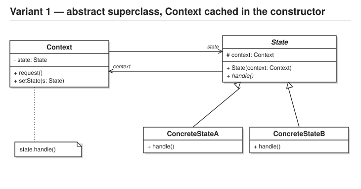
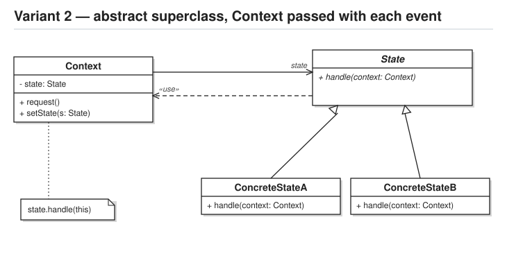
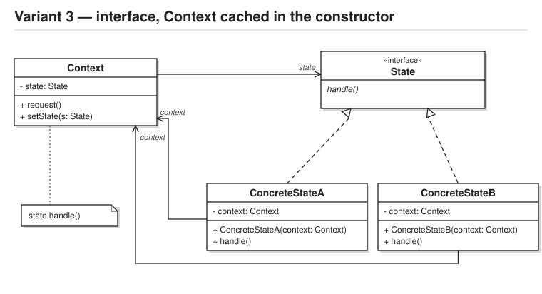
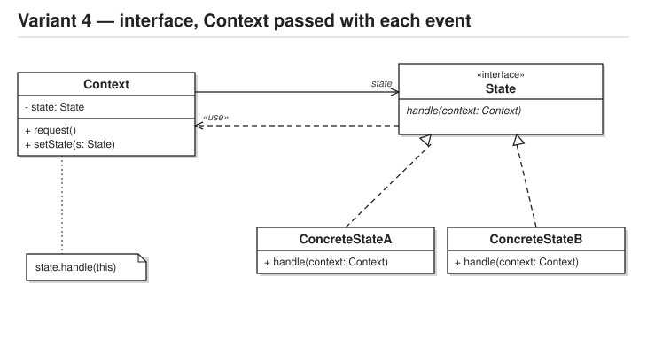
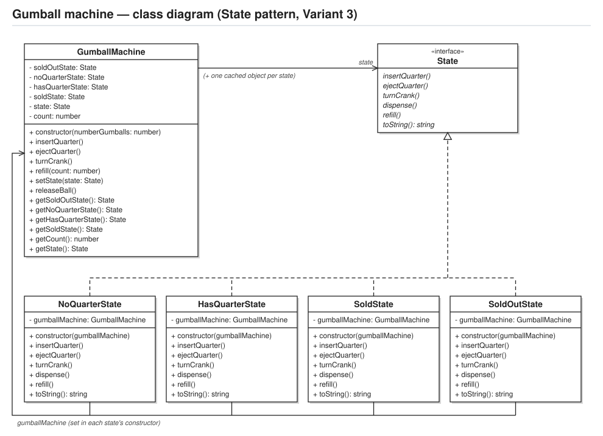

# The State Pattern: four ways to draw it

**COMP Design Patterns · Week 9 (State)**

The **State Pattern** lets an object change its behaviour when its internal state changes, so that the object appears to
change its class. Instead of one large class full of `if`/`switch` statements on a state variable, each state is
written as its own class. 

The **Context** is the object with the changing behaviour.

The **Context** keeps a reference to its **current
State** object and **delegates** each request to it: `request()` simply calls `state.handle()`. A transition to a new
state is just `context.setState(...)` with a different State object, so new states can be added as new classes without
rewriting the Context (*encapsulate what varies*, *favour composition over inheritance*, *open–closed*).

This is the same class diagram as the Strategy Pattern, but the intent differs. A Strategy is usually chosen by the
client and rarely changes. A State changes internally, again and again, as events arrive.

Two design decisions give 4 variants of the diagram:

|                               | Context **cached** in the constructor | Context **passed** with each event |
| ----------------------------- | ------------------------------------- | ---------------------------------- |
| **abstract superclass** State | [Variant 1](#variant-1--abstract-superclass-context-cached-in-the-constructor) | [Variant 2](#variant-2--abstract-superclass-context-passed-with-each-event) |
| **interface** State           | [Variant 3](#variant-3--interface-context-cached-in-the-constructor) | [Variant 4](#variant-4--interface-context-passed-with-each-event) |

The Context is the same in every variant, apart from what it passes to `handle()`:

```ts
class Context {
  private state: State;
  constructor(initial: State) { this.state = initial; }
  setState(state: State) { this.state = state; }
  request() { this.state.handle(); }          // variants 1 and 3
  // request() { this.state.handle(this); }   // variants 2 and 4
}
```

---

<a id="variant-1--abstract-superclass-context-cached-in-the-constructor"></a>



The abstract `State` class holds a **protected** `context` field and sets it in its constructor, so this code is
written once and every subclass inherits it. 

The superclass can also give default behaviour (for example "that action
isn't allowed now"), so each concrete state only overrides the events it cares about. Each Context needs **its own**
set of State objects.

```ts
abstract class State {
  constructor(protected context: Context) {}
  abstract handle(): void;
}

class ConcreteStateA extends State {
  handle() { this.context.setState(new ConcreteStateB(this.context)); }
}
```

<a id="variant-2--abstract-superclass-context-passed-with-each-event"></a>



`State` keeps no reference. The Context passes itself on every call, `state.handle(this)`, so the link back to the
Context is only a **dependency** (dashed arrow). The State objects hold no data, so one instance of each can be
**shared** by every Context, for example as a static instance.

```ts
abstract class State {
  abstract handle(context: Context): void;
}

class ConcreteStateA extends State {
  static readonly instance = new ConcreteStateA();
  handle(context: Context) { context.setState(ConcreteStateB.instance); }
}
```

<a id="variant-3--interface-context-cached-in-the-constructor"></a>



`State` is an **interface**, so each concrete state must declare its own `context` field and constructor, and must
implement every method (there are no inherited defaults). This is the version used in *Head First Design Patterns*
(the gumball machine). As in Variant 1, each Context needs its own State objects.

```ts
interface State {
  handle(): void;
}

class ConcreteStateA implements State {
  constructor(private context: Context) {}
  handle() { this.context.setState(new ConcreteStateB(this.context)); }
}
```

<a id="variant-4--interface-context-passed-with-each-event"></a>



The States are pure behaviour: no fields, no constructor, only methods that receive the Context. Like Variant 2 they
can be **shared** between Contexts (singletons, static instances or constant objects), and like Variant 3 every state
implements every method.

```ts
interface State {
  handle(context: Context): void;
}

class ConcreteStateA implements State {
  static readonly instance = new ConcreteStateA();
  handle(context: Context) { context.setState(ConcreteStateB.instance); }
}
```

---

## Choosing between them

- **Cached reference (1, 3):** shorter method signatures, and a state can keep its own data. But each Context needs
  its own State objects.
- **Context as a parameter (2, 4):** longer signatures, but the states are stateless and can be shared by many
  Contexts.
- **Abstract superclass (1, 2):** shared fields and default behaviour are written once. But it uses up the class's
  single superclass (in Java, C# and TypeScript).
- **Interface (3, 4):** the most flexible typing, but there are no defaults, so every state implements every method.

---

## The gumball machine code (`src/`)

[`src/`](src/) holds a TypeScript (Deno) version of the *Head First* gumball machine. It uses
**[Variant 3](#variant-3--interface-context-cached-in-the-constructor)**: `State` is an interface, and each concrete
state receives the machine in its constructor and keeps it in a private field.

| File | Role in the pattern |
| ---- | ------------------- |
| [`src/GumballMachine.ts`](src/GumballMachine.ts) | the **Context** |
| [`src/states/State.ts`](src/states/State.ts) | the **State** interface: one method per action |
| [`src/states/NoQuarterState.ts`](src/states/NoQuarterState.ts), [`HasQuarterState.ts`](src/states/HasQuarterState.ts), [`SoldState.ts`](src/states/SoldState.ts), [`SoldOutState.ts`](src/states/SoldOutState.ts) | the **ConcreteStates** |
| [`src/main.ts`](src/main.ts) | the client: a text menu that drives one machine |

Run it from this folder with:

```bash
deno run src/main.ts
```



This is [Variant 3](#variant-3--interface-context-cached-in-the-constructor) filled in with the real classes:

- `GumballMachine` is the **Context**. Its `state` field is the current state, and it also keeps one object of each
  concrete state (`soldOutState`, `noQuarterState`, ...), created once in its constructor with `new NoQuarterState(this)`
  and so on.
- `State` is the **interface**, with one method per action: the four from the state chart, plus `refill()` and
  `toString()`.
- Each of the four **concrete states** implements **every** method of the interface, and keeps a private
  `gumballMachine` reference that it receives in its constructor (the line along the bottom).
- The getters (`getNoQuarterState()` and so on) and `setState()` are there for the State classes. That is how a state
  moves the machine on without creating another state object.


The two diamonds are **choice** pseudostates: one event, with the next state picked by a guard on the gumball count.

- When the machine is created (`new`), the starting count decides whether it begins in `NoQuarter` or `SoldOut`. This
  is the `if` in the `GumballMachine` constructor.
- After `dispense()` in `Sold`, the remaining count decides between `NoQuarter` and `SoldOut`. This is the `if` in
  `SoldState.dispense()`.

Each arrow in this chart is **one `setState(...)` call in one State class**. For example, the
`NoQuarter → HasQuarter` arrow is in `NoQuarterState.insertQuarter()`:

```ts
public insertQuarter(): void {
  console.log("You inserted a quarter");
  this.gumballMachine.setState(this.gumballMachine.getHasQuarterState());
}
```

Any action that has no arrow out of a state is still a method in that state's class. It just prints a message and
leaves the state as it is (for example `SoldState.turnCrank()` prints "Turning twice doesn't get you another
gumball!").

### Things to notice

- **The Context has no conditionals about state.** Every action in `GumballMachine` is one line that delegates to
  `this.state`. The only `if` is in the constructor, which picks the **initial state** from the gumball count.
- **The Context creates and owns its four State objects.** It builds them once, passing `this`, and keeps them in
  fields (`soldOutState`, `noQuarterState`, ...). This is the "one set of states per machine" cost of a cached
  reference.
- **The State classes control the transitions.** They choose the next state through the Context's getters
  (`getHasQuarterState()` and so on), so no state class needs to import or construct another. `SoldState.dispense()`
  shows a transition with a **guard**: it goes to `NoQuarter` or `SoldOut` depending on `getCount()`.

- **`refill()` was added after the first design.** It is the extra action that *Head First* adds later in the
  chapter. Adding it meant one new method in the interface and in every concrete state, but only `SoldOutState` does
  anything with it. With an abstract superclass ([Variant 1](#variant-1--abstract-superclass-context-cached-in-the-constructor)),
  the other three states could simply inherit an empty default.
- **`toString()` is part of the interface** so that `main.ts` can print the current state (`NO_QUARTER`,
  `HAS_QUARTER`, ...) without knowing which class it is.

### Exercises

1. Add the *Head First* **`WinnerState`**: one turn in ten gives two gumballs. Which existing classes did you have to
   change, and which didn't you have to touch?
2. Convert the code to **[Variant 4](#variant-4--interface-context-passed-with-each-event)**: pass the machine to each
   action, and share one instance of each state between two machines.
3. Convert the code to **[Variant 1](#variant-1--abstract-superclass-context-cached-in-the-constructor)**: move the
   field, the constructor and the "do nothing" methods into an abstract `State` class. How much shorter do the
   concrete states get?

## References

- Freeman, E. & Robson, E. (2020) *Head First Design Patterns*, 2nd edn. O'Reilly. Chapter 10: The State Pattern.
- Gamma, E., Helm, R., Johnson, R. & Vlissides, J. (1995) *Design Patterns: Elements of Reusable Object-Oriented
  Software*. Addison-Wesley. State, p. 305.
