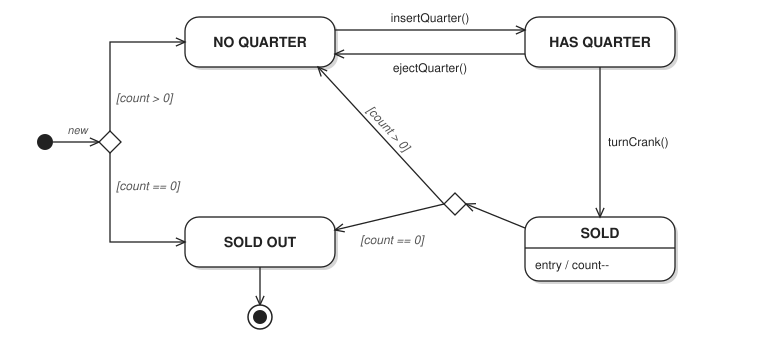
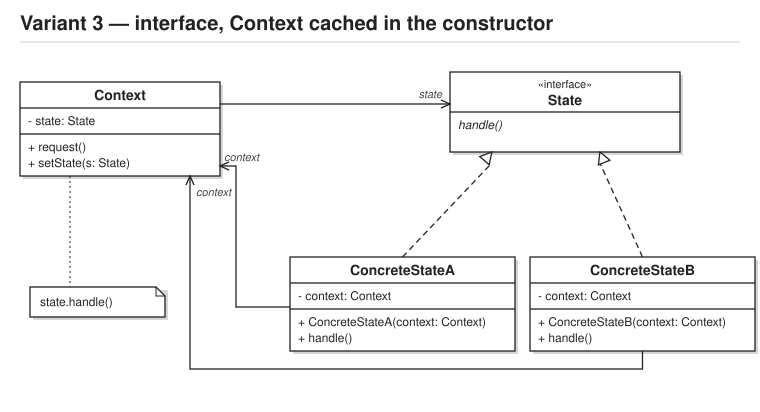

# Question 1

## the State Machine Diagram  to implement

Gumball machine State Machine Diagram


NOTES:
1. The constructor for the Gumball Machine class should accept an integer, which is the initial number of gumballs (`count`) in the machine

1. Each State object should return its name in CAPS in a `toString()` method
    - e.g.
        ```typescript
        public toString(): string {
            return "SOLD";
        }
        ```

1. your system should log to the console appropriate messages when each event is processed 
    - An event that is valid should change state, and print a message saying it's changing to the new state.
    - An event that is NOT valid in the current state must leave the state unchanged, and print a message saying why.

    - e.g. 
        - `You inserted a quarter`
        - `You can't insert another quarter`
        - `You can't eject, you haven't inserted a quarter yet`

## the state pattern variant to demonstrate



## `main.ts` - sample text-driven menu

You have been provided with a sample main.ts for a text-driven menu to interactively drive your implementation

The terminal output should look something like the following:

```bash
question1 % deno run src/main.ts
---------------------------
State: NO_QUARTER
Gumballs: 2

1 - insert a quarter
2 - eject the quarter
3 - turn the crank
q - quit
> 1
You inserted a quarter
---------------------------
State: HAS_QUARTER
Gumballs: 2

1 - insert a quarter
2 - eject the quarter
3 - turn the crank
q - quit
> 
```

# Question 2

create a copy of your question 1 project, and implement the following additional functionality:

- if a `refill()` message is received
    - IF the Gumball machine is in the `SoldOut` state 
        - THEN it 
           1. addes 5 gumballs to the machines count
           2. transitions into the `NoQuarter` state 
    - IF the Gumball machine was in any other state
        - THEN there is no change of state, and an appropriate message is logged to the console