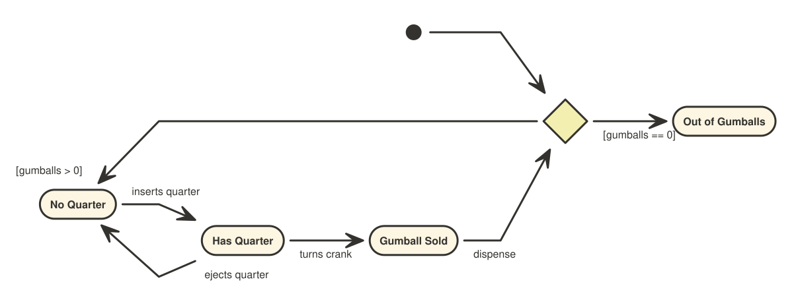
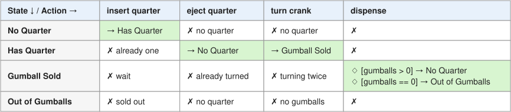

# Gumball version 1 - IF-statements

naive, simple version of the Gumball machine from chapter 10 of Head First Design Patterns

## The states

The states are constants (`static readonly`) in `GumballMachine`, and every action is an if / else-if chain
that asks "which state am I in?".

## Every state × every action

Only the **4 green cells** change the state — they are the state chart's arrows. The other **12 cells** are still behaviour the code must handle.

**◇** = the decision diamond on the state chart: the guard in [ ] picks the next state.

## Printing messages

Like the book's `System.out.println`, each action prints what happened with `console.log`
(for example `"You inserted a quarter"`), so the code reads line-for-line like the Java in chapter 10.

`src/main.ts` is a text menu to try the machine (use the RUN shortcut in the terminal).

