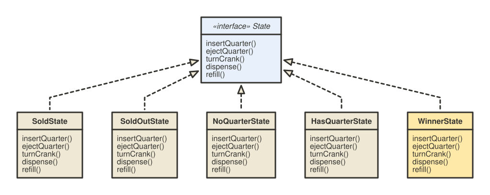
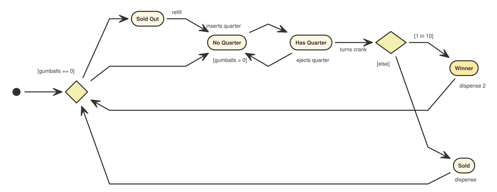
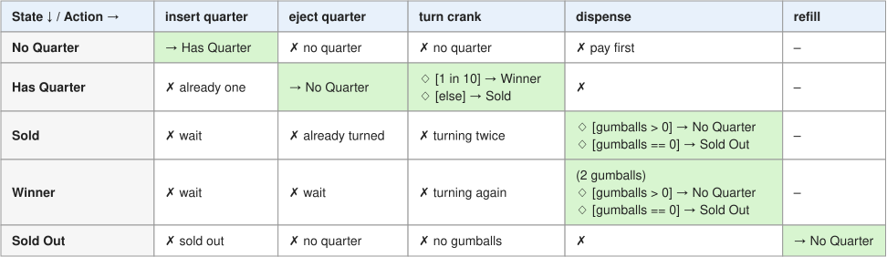

# Gumball version 3 - the State pattern, with a WINNER state

The Gumball machine from chapter 10 of Head First Design Patterns, using the **State pattern**, after the
change request: *1 in 10 times, the customer gets two gumballs instead of one.*

- `src/State.ts` - the interface: one method per action
- `src/NoQuarterState.ts`, `HasQuarterState.ts`, `SoldState.ts`, `SoldOutState.ts` - one class per state
- `src/WinnerState.ts` - **new**: gives out two gumballs
- `src/HasQuarterState.ts` - **changed**: turning the crank picks `SoldState` or (1 in 10) `WinnerState`
- `src/GumballMachine.ts` - **changed**: holds the new state too
- `src/main.ts` - a text menu to try the machine (use the RUN shortcut in the terminal)
- `tests/` - tests for the machine (`deno task test`) - they pass in their own "random" so they can decide who wins

## Printing messages

Like the book's `System.out.println`, each action prints what happened with `console.log`
(for example `"You inserted a quarter"`), so the code reads line-for-line like the Java in chapter 10.

Printing makes the machine a little harder to test: the tests in `tests/` use a small `printed(...)` helper
that swaps `console.log` for a function that collects the lines, runs the action, then puts `console.log` back.

## The classes (Head First Design Patterns, chapter 10)

Each state class implements the `State` interface, so each one answers every action.
`WinnerState` is the only new class: adding a state means adding a class.
(The book's diagram shows four actions; the code also has `refill()`.)

## The states

## Every state × every action

Only the **6 green cells** change the state — they are the state chart's arrows. The other **19 cells** are still behaviour the code must handle.

**◇** = the decision diamond on the state chart: the guard in [ ] picks the next state.

The new state is **one new row** = one new class (`WinnerState`). Only one existing cell changed: Has Quarter × turn crank.
